# Laboratorio: API serverless observable en GCP (CC3106 · UVG)

API de pedidos en **Cloud Run functions**, una hora de tráfico simulado con
errores intencionales y un **dashboard de Cloud Monitoring** que combina
métricas nativas, métricas basadas en logs, SQL de Log Analytics y un panel de logs.

- Enunciado: [docs/Laboratorio_API_observable_GCP.pdf](docs/Laboratorio_API_observable_GCP.pdf)
- Diagrama objetivo: [docs/arquitectura_lab_gcp.webp](docs/arquitectura_lab_gcp.webp)
- Guía del dashboard: [lab/dashboard/GUIA.md](lab/dashboard/GUIA.md)
- Resultados de la corrida: [sección Resultados](#resultados)

```
lab/
  infra/       Terraform (copiado del enunciado): función, cuentas de servicio, bucket, Log Analytics
  backend/     main.py (entry point handle) + requirements.txt  ← esto se zipea y despliega
  simulator/   simulator.py + config.json  → genera requests.csv
  dashboard/   métricas de logs (YAML), SQL, dashboard.json, commands.sh, GUIA.md
  tests/       pytest del backend + compare_csv_logs.py (cruce CSV ↔ logs)
```

## API

| Operación | Ruta | Éxito | Errores |
|---|---|---|---|
| Crear pedido | `POST /orders` `{customer_id, customer_tier, category, amount}` | 201 | 400 payload inválido |
| Consultar | `GET /orders/{id}` | 200 | 404 ID inexistente |
| Cancelar | `POST /cancel/{id}` | 200 | 404 · 409 ya cancelado / pedido `digital` ya entregado |

- `customer_tier`: `free | standard | pro` · `category`: `electronics | books | clothing | home | digital` · `0 < amount ≤ 10000`.
- `FAILURE_RATE` → 500 simulado (solo en solicitudes válidas) · `EXTRA_LATENCY_MS` → latencia extra.
- Cada solicitud escribe **una línea JSON** en stdout: `severity`, `message="request_completed"`,
  `request_id` (header `X-Request-ID`), `endpoint`, `status_code`, `outcome`, `error_type`,
  `latency_ms`, `customer_tier`, `category`, `amount`, `order_id`.
- El `order_id` es autocontenido (tier-categoría-centavos-nonce-checksum), así que cualquier
  instancia lo resuelve aunque la memoria no se comparta entre instancias.
  El "ya cancelado" sí vive en memoria de cada instancia; el 409 determinista es cancelar un `digital`.

## Requisitos
- Python 3.13, `gcloud` y Terraform ≥ 1.5. Si no tienes Terraform instalado, el repo usa
  un binario local en `.tools/terraform.exe` (ignorado por git):
  `TF=./.tools/terraform.exe` (o `TF=terraform` si lo tienes en el PATH).
- Git Bash en Windows para los comandos de abajo.

## Correr el lab (orden exacto)

```bash
# 0) Entorno local (una vez)
python -m venv .venv
.venv/Scripts/python -m pip install -r lab/backend/requirements.txt -r lab/simulator/requirements.txt pytest
.venv/Scripts/python -m pytest lab/tests -q            # 11 pruebas: 201/200/400/404/405/409/500 + formato del log
TF=./.tools/terraform.exe

# 1) Autenticación
gcloud auth login
gcloud auth application-default login
export PROJECT_ID="tu-proyecto"                         # ← tu project_id real
gcloud config set project "$PROJECT_ID"

# 2) Variables de Terraform: edita lab/infra/terraform.tfvars (project_id real)
#    y evita commitearlo por accidente:
git update-index --skip-worktree lab/infra/terraform.tfvars

# 3) Infraestructura  (si el primer apply falla en el build, espera 1 min y repite)
$TF -chdir=lab/infra init
$TF -chdir=lab/infra plan
$TF -chdir=lab/infra apply

# 4) URL de la función → config.json
URL=$($TF -chdir=lab/infra output -raw function_url)
.venv/Scripts/python -c "import json,sys;p='lab/simulator/config.json';c=json.load(open(p));c['target_url']=sys.argv[1];json.dump(c,open(p,'w'),indent=2)" "$URL"
git update-index --skip-worktree lab/simulator/config.json

# 5) Métricas basadas en logs (ANTES del simulador) y dashboard
bash lab/dashboard/commands.sh check                   # confirma que llegan los logs
bash lab/dashboard/commands.sh metrics
bash lab/dashboard/commands.sh dashboard

# 6) Simulador: 60 minutos reales (6000 solicitudes, pico ≈ 4 req/s)
.venv/Scripts/python lab/simulator/simulator.py --dry-run   # opcional: revisa el plan
.venv/Scripts/python lab/simulator/simulator.py             # escribe lab/simulator/requests.csv

# 7) Paneles SQL: lab/dashboard/GUIA.md, paso 5 (Log Analytics → Add to dashboard)
$TF -chdir=lab/infra output log_analytics_view

# 8) Limpieza
bash lab/dashboard/commands.sh cleanup                 # métricas de logs + dashboard
$TF -chdir=lab/infra destroy
```

### Flags del simulador
| Flag | Uso |
|---|---|
| `--time-scale 60` | comprime la hora: 60 = todo en 1 minuto (solo para pruebas) |
| `--dry-run` | genera el plan (`requests_plan.csv`) sin HTTP e imprime μ, σ y el pico |
| `--limit 200` | genera solo 200 solicitudes con la misma distribución |
| `--url http://127.0.0.1:8080` | sobrescribe `target_url` |
| `--out archivo.csv` | cambia el CSV de salida |

`requests.csv`: `request_id, scheduled_min, scheduled_at, sent_at, send_lag_ms, operation,
intended_event, detail, method, path, category, customer_tier, amount, expected_status,
status_code, client_latency_ms, error`.

## Prueba local (sin GCP)

```bash
# Terminal 1: la función en local (PYTHONDONTWRITEBYTECODE evita __pycache__ en lab/backend)
cd lab/backend
FAILURE_RATE=0.02 PYTHONDONTWRITEBYTECODE=1 PYTHONUNBUFFERED=1 \
  ../../.venv/Scripts/functions-framework --target handle --source main.py \
  --host 127.0.0.1 --port 8080 > ../../backend_local.log

# Terminal 2: 500 solicitudes en ~6 min y cruce CSV ↔ logs
.venv/Scripts/python lab/simulator/simulator.py --url http://127.0.0.1:8080 --limit 500 --time-scale 10
.venv/Scripts/python lab/tests/compare_csv_logs.py lab/simulator/requests.csv backend_local.log
```

Usa `127.0.0.1` y no `localhost`: en Windows, `localhost` intenta IPv6 primero y suma ~300 ms por conexión.
El servidor de desarrollo local se satura arriba de ~50 req/s; con `--time-scale` alto
la espera aparece en `send_lag_ms`. En Cloud Run eso no pasa a 4 req/s.

## Resultados

Corrida completa del 15 de octubre de 2026, de 19:15 a 20:15 (CST, UTC-6): 6000 solicitudes,
`seed = 42`, μ = 30 min, σ = 10 min, `invalid_share = 0.08`, `FAILURE_RATE = 0.02`.
En los logs aparecen 6002 entradas: las 6000 del simulador y 2 pruebas manuales hechas antes de la corrida.
Esas pruebas son `smoke-1` (201, a las 01:11:39 UTC) y una solicitud sin `X-Request-ID` a una ruta inexistente (404 `route_not_found`, a las 01:14:41 UTC).

### Salida del simulador

```text
PS> .\.venv\Scripts\python lab\simulator\simulator.py
Plan: 6000 solicitudes · μ=29.91 min · σ=9.88 min · pico=274 req/min (4.6 req/s) en el min 33
  eventos: {'valid': 5486, 'impossible_cancel': 121, 'nonexistent_cancel': 73, 'invalid_payload': 215, 'nonexistent_get': 105}
  operaciones válidas: {'cancel': 821, 'get': 1422, 'create': 3243}
  escenario: 415 solicitudes afectadas, 74 con error intencional (17.8%)
Inicio de la corrida: 2026-10-16T01:15:09.066Z (UTC) · 6000 solicitudes · time_scale=1.0
Fin estimado: 2026-10-16T02:15:09.066Z
  600/6000 enviadas · {200: 224, 201: 323, 400: 15, 404: 11, 409: 12, 500: 15}
  1200/6000 enviadas · {200: 445, 201: 641, 400: 31, 404: 36, 409: 26, 500: 21}
  1800/6000 enviadas · {200: 664, 201: 964, 400: 56, 404: 46, 409: 40, 500: 30}
  2400/6000 enviadas · {200: 865, 201: 1293, 400: 79, 404: 65, 409: 56, 500: 42}
  3000/6000 enviadas · {200: 1080, 201: 1627, 400: 97, 404: 81, 409: 66, 500: 49}
  3600/6000 enviadas · {200: 1321, 201: 1931, 400: 121, 404: 89, 409: 78, 500: 60}
  4200/6000 enviadas · {200: 1522, 201: 2255, 400: 146, 404: 118, 409: 84, 500: 75}
  4800/6000 enviadas · {200: 1757, 201: 2561, 400: 168, 404: 133, 409: 96, 500: 85}
  5400/6000 enviadas · {200: 1977, 201: 2865, 400: 195, 404: 160, 409: 111, 500: 92}
  6000/6000 enviadas · {200: 2194, 201: 3189, 400: 215, 404: 178, 409: 121, 500: 103}
Listo: ...\lab\simulator\requests.csv · códigos: {200: 2194, 201: 3189, 400: 215, 404: 178, 409: 121, 500: 103}
```

- Plan (antes de enviar): 5486 válidas y 514 errores intencionales (8.6%). El escenario
  afectó 415 solicitudes de electronics en los minutos 35–45, con 17.8% de error.
- `Inicio de la corrida` es el minuto 0 para estimar μ en SQL: `TIMESTAMP('2026-10-16T01:15:09Z')`.
- El resultado final cuadra con el plan: 215 × 400 = `invalid_payload`;
  178 × 404 = 105 `nonexistent_get` + 73 `nonexistent_cancel`; 121 × 409 = `impossible_cancel`.
  Los 103 × 500 salen de `FAILURE_RATE` sobre solicitudes válidas.

### Resumen numérico

| Qué | Configurado / esperado | Simulador (`requests.csv`) | Medido en GCP |
|---|---|---|---|
| Solicitudes | 6000 | 6000 enviadas, 0 errores de red | 6002 logs `request_completed` (6000 + 2 pruebas); las 6000 cruzan por `request_id` con 0 diferencias de status |
| μ de llegada | 30 min | 29.91 min | **29.91 min** desde el inicio real (logs exportados); 33.39 min en el panel SQL con `MIN(timestamp)` (ver nota) |
| σ de llegada | 10 min | 9.88 min | **9.88 min** (logs exportados); 9.9 min en el panel SQL |
| Pico de tráfico | ≈ 240/min (≈ 4/s) | 274/min en el plan | ≈ 260/min (panel nativo) |
| 201 crear | — | 3189 | 3190 (incluye `smoke-1`) |
| 200 consultar + cancelar | — | 2194 | 1390 + 804 = 2194 |
| 400 payload inválido | — | 215 | 215 |
| 404 inexistente | — | 178 | 178 (+1 `route_not_found` de la prueba manual) |
| 409 cambio imposible | — | 121 | 121 (`order_fulfilled`) |
| 500 falla simulada | ≈ 2% de válidas | 103 (1.9% de 5486 válidas) | 103 |
| Errores intencionales electronics, min 35–45 | 2 × 8% = 16% | 17.5% (74/422) | ventana con más client_error en `07` |
| Errores intencionales electronics, resto | 8% | 7.9% (111/1403) | — |
| Instancias activas | máx. 10 | — | 1, con picos de 2 |
| Latencia (nativa, Cloud Run) | — | cliente: p50 101 ms, p95 240 ms | p50 ≈ 5 ms, p95 ≈ 9.5 ms tras el arranque en frío |
| Latencia dentro del handler (log) | — | — | p50 0.1 ms, p95 0.2 ms |
| % 4xx / % 5xx (Cloud Run Monitoring) | ≈ 8% / ≈ 2% | 514 / 103 de 6000 | 8.581% (515/6002) / 1.716% (103/6002) |
| CPU / memoria del contenedor | — | — | CPU p50 ≤ 1%, memoria p50 ≈ 14–17% |

Cada `request_id` de `requests.csv` tiene su línea de log con el mismo `status_code`. Los únicos
desvíos respecto del código esperado son los 103 errores 500 de `FAILURE_RATE` (55 en crear y 48 en consultar/cancelar).

> **Nota sobre μ = 33.39.** La consulta `02_mu_sigma_estimates.sql` toma como minuto 0 la
> **primera solicitud registrada**. En esta corrida, esa primera solicitud fue la prueba manual
> `smoke-1` (01:11:39 UTC), 3.49 min antes de arrancar el simulador (01:15:09 UTC). Por eso `ultimo_min = 63.46` (más de 60)
> y todas las llegadas quedan corridas ≈ +3.5 min: 33.39 − 3.48 = **29.91**, exactamente el μ del plan.
> σ casi no cambia porque no depende del origen. Para obtener el valor correcto, descomenta
> `run_start` en la consulta y usa la hora de inicio que imprime el simulador:
> `TIMESTAMP('2026-10-16T01:15:09Z')`.

### Métricas nativas: solicitudes y latencia
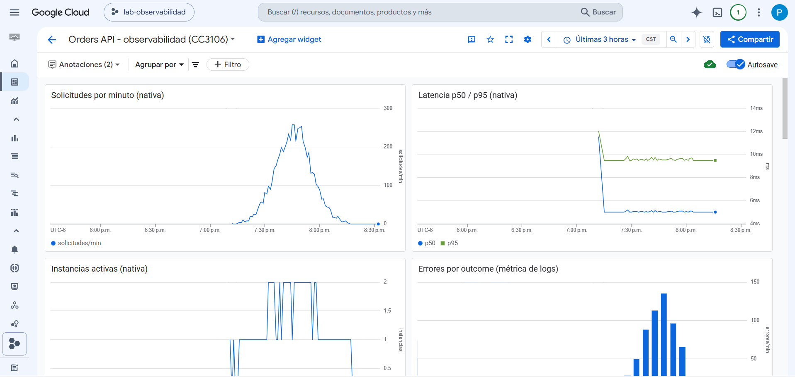

- **Solicitudes por minuto:** campana centrada cerca de las 19:45 (minuto 30 de la corrida), con pico de ≈ 260/min. Coincide con N(30, 10).
- **Latencia p50 / p95:** el primer punto es alto (≈ 12 ms) por el arranque en frío. Después p50 se estabiliza en ≈ 5 ms y p95 en ≈ 9.5 ms. La latencia no crece con el tráfico.

### Instancias activas y errores por outcome
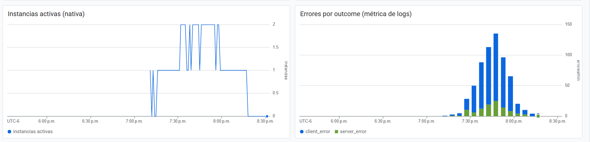

- **Instancias activas:** con `concurrency = 1`, una sola instancia alcanza para casi todo el tráfico (≈ 4 req/s × 5 ms). Cerca del pico sube a 2 y vuelve a 1. Al terminar baja a 0 (`min_instance_count = 0`).
- **Errores por outcome** (métrica basada en logs): `client_error` (4xx intencionales) domina. `server_error` (500 de `FAILURE_RATE`) es una fracción pequeña y constante. Ambos siguen la forma de la campana porque son proporcionales al tráfico.

### Errores por tipo y monto de pedidos
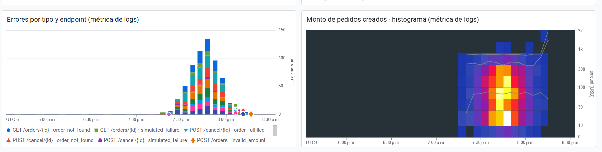

- **Errores por tipo y endpoint:** desglose en bloques de 5 min de `order_not_found`, `order_fulfilled`, `invalid_amount`, `simulated_failure`, etc., por endpoint.
- **Histograma de monto** (métrica de distribución `orders_amount`): la mayoría de los pedidos están entre 10 y 300 USD, con una cola hasta ≈ 1–3k (electronics). Las líneas grises son percentiles.

### Panel de logs (severity ≥ WARNING)
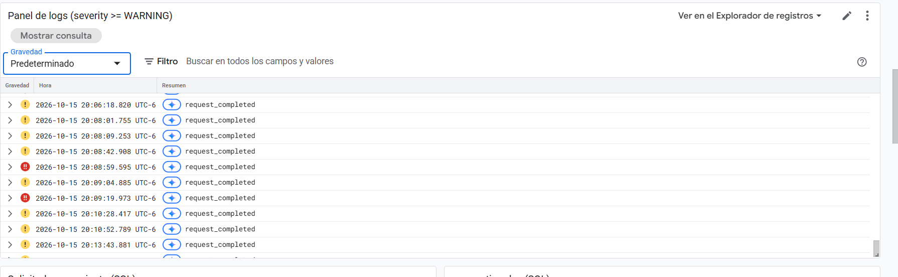

Muestra solo `request_completed` con WARNING (4xx, ícono amarillo) o ERROR (500, ícono rojo).
Al expandir una fila se ven todos los campos del log estructurado (`request_id`, `endpoint`, `error_type`, `amount`…).

### Log Analytics (SQL)

| Solicitudes por minuto | Errores por outcome |
|---|---|
| 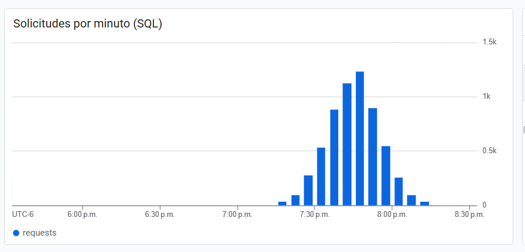 | 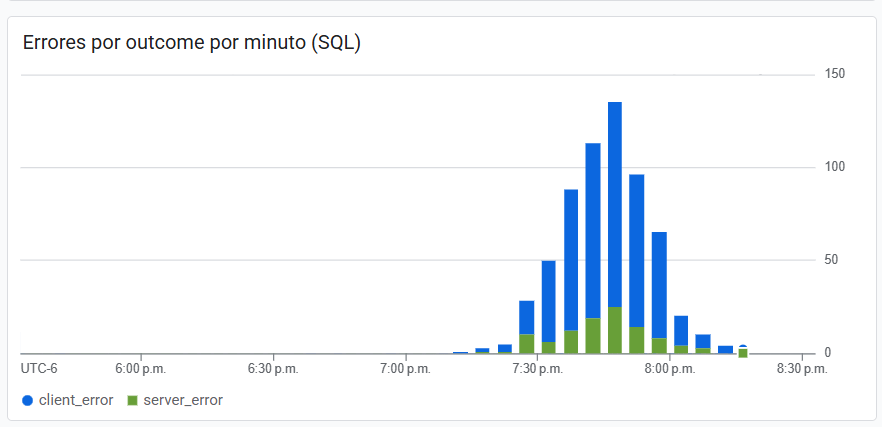 |

Las barras SQL se ven más altas que las del panel nativo: el gráfico agrupa en intervalos de
5 min (≈ 1.2k solicitudes en el intervalo del pico ≈ 5 × 245/min). La forma es la misma.

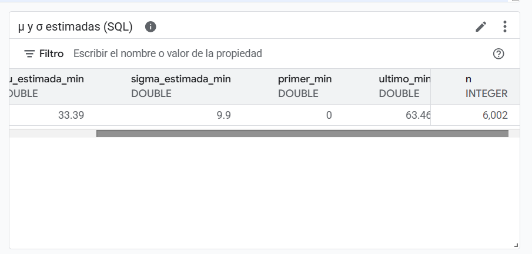

μ = 33.39 y σ = 9.9 sobre n = 6002; ver la nota de arriba sobre el corrimiento de ≈ +3.5 min.

| Escenario electronics | Resumen por outcome | Latencia y monto |
|---|---|---|
| 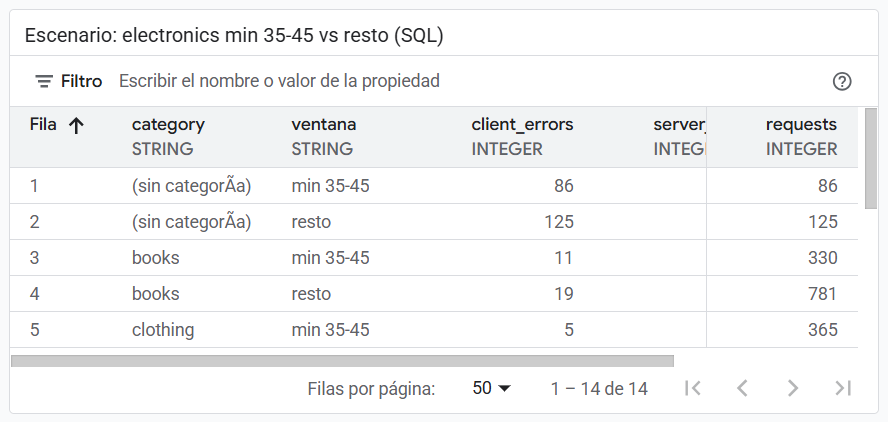 | 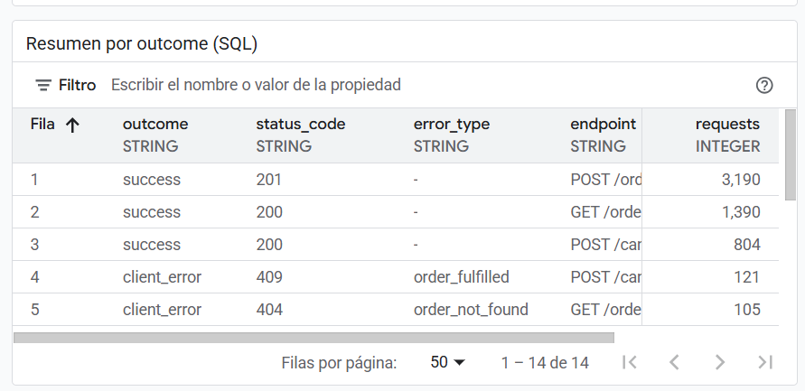 | 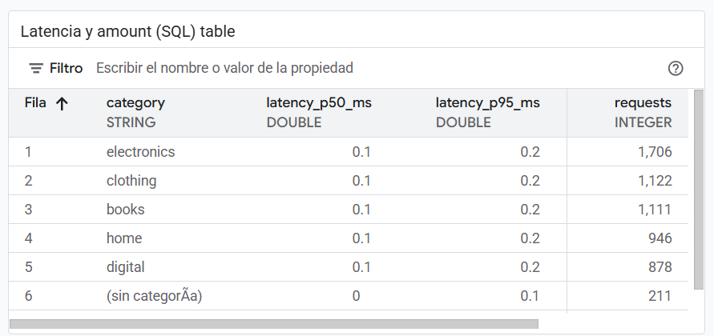 |

- **Escenario:** compara la tasa de error por categoría dentro y fuera de los minutos 35–45. Las filas `(sin categoría)` son los 404 de IDs inexistentes, que no tienen categoría.
- **Resumen:** 3190 × 201, 1390 × 200 (GET), 804 × 200 (cancel), 121 × 409, 105 × 404 (GET)… Coincide con `requests.csv`.
- **Latencia en el handler:** ≈ 0.1 ms. Casi todo el tiempo que ve el cliente (p50 101 ms) es red y la capa de Cloud Run, no el código.

### Dashboard completo
El dashboard final reúne las cuatro fuentes: nativas, métricas de logs, panel de logs y SQL.

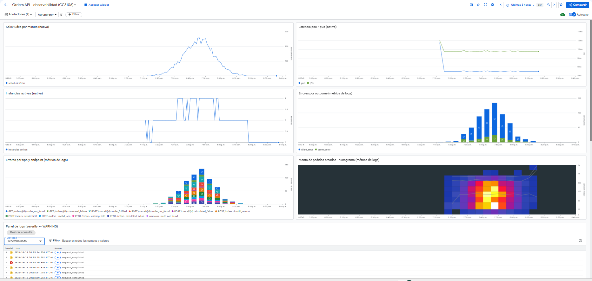
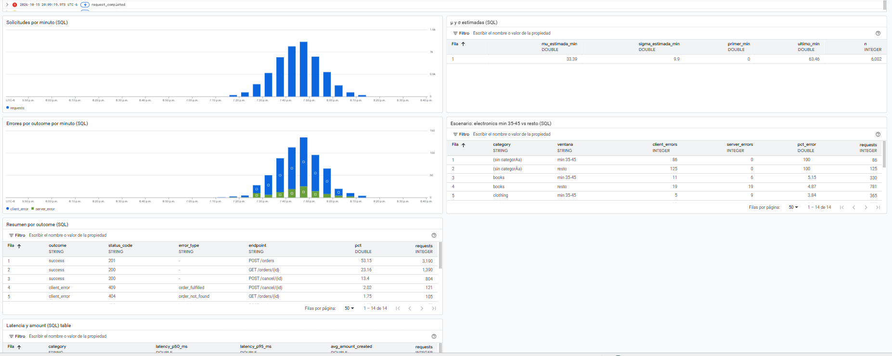

Así aparece en la lista de dashboards del proyecto, junto a los que Google crea solo:

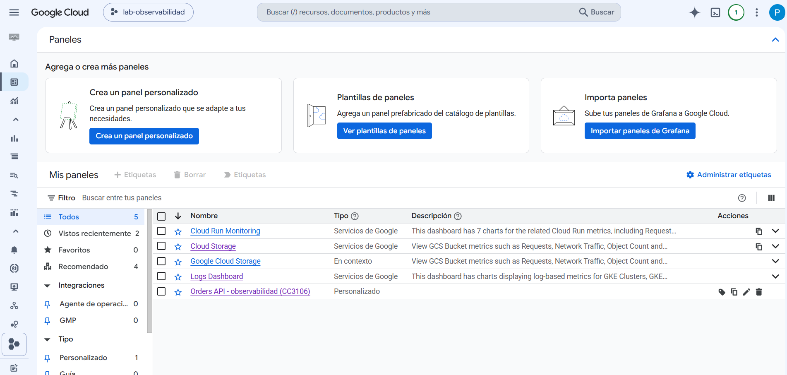

### Cloud Run Monitoring (dashboard automático de Google)
Sirve para contrastar el dashboard propio con el que trae Cloud Run.

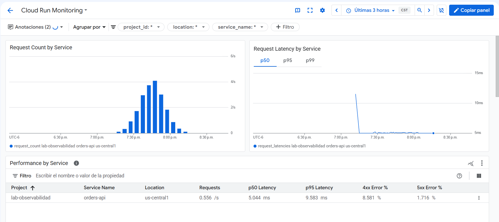

- Pico de ≈ 4.3 req/s, que coincide con el ≈ 4 req/s esperado.
- p50 = 5.04 ms y p95 = 9.58 ms, igual que el panel propio.
- **4xx = 8.581% y 5xx = 1.716%:** coinciden exactamente con 515/6002 y 103/6002 de los logs.

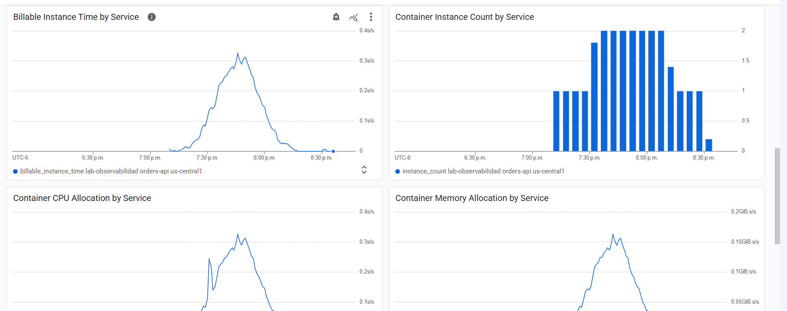
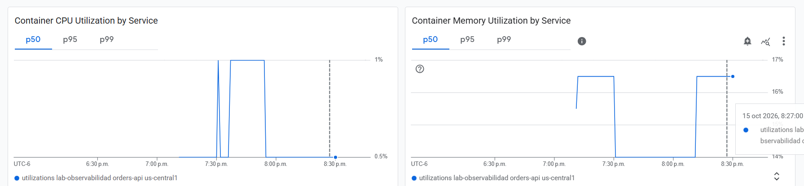

- El tiempo facturable sigue la campana con un máximo de ≈ 0.3 s/s: con `min_instance_count = 0`, solo se paga mientras hay tráfico.
- Máximo 2 instancias. CPU p50 ≤ 1% y memoria ≈ 14–17% de 512 MiB: la función está muy holgada para esta carga.

### Conclusiones
1. **Las tres fuentes cuentan la misma historia:** métricas nativas, métricas basadas en logs y SQL muestran la misma campana y los mismos totales que `requests.csv`, la verdad de referencia del cliente.
2. **La distribución se recupera desde los logs:** desde el inicio real de la corrida, los timestamps de GCP dan μ = 29.91 y σ = 9.88, idénticos al plan. Las pruebas previas en la misma ventana sesgan μ si se usa `MIN(timestamp)`.
3. **La API no se saturó:** latencia plana, máximo 2 instancias y 0 errores de red. Los errores observados son exactamente los intencionales (4xx) más los simulados (500).
4. **El escenario `double_errors` se detecta:** electronics en los minutos 35–45 tuvo 17.5% de errores intencionales, contra 7.9% en el resto (≈ 2×).
5. **Los logs estructurados son la pieza clave:** gracias a `request_id`, `outcome` y los atributos de negocio en una línea JSON, cada pregunta del dashboard se respondió con un filtro o una consulta, sin tocar el código.

## Respaldo (antes de borrar los recursos)
Tras `terraform destroy` y `commands.sh cleanup`, el dashboard y las métricas dejan de existir.
`docs/respaldo/` guarda lo necesario para reconstruirlos y para verificar los resultados:

| Archivo | Contenido |
|---|---|
| `dashboard_final.json` | El dashboard tal como quedó, incluidos los paneles SQL. Se puede reimportar con `gcloud monitoring dashboards create --config-from-file` (quitando `name` y `etag`). |
| `metric_orders_requests_by_outcome.yaml`, `metric_orders_amount.yaml` | Las métricas basadas en logs, exportadas de GCP |
| `requests_corrida.csv` | La verdad de referencia del simulador (6000 filas) |
| `logs_corrida.csv` | Los 6002 logs `request_completed`, exportados desde Log Analytics |
| `logs_corrida.json` | Los mismos logs en el formato completo de Cloud Logging |

Verificación con los archivos de respaldo:
- Las 6000 filas de `requests_corrida.csv` aparecen en `logs_corrida.csv` con el mismo `status_code`.
- Solo hay 2 logs extra, las pruebas manuales.
- Medido desde 01:15:09 UTC, los timestamps de los logs dan μ = 29.91 y σ = 9.88.

## Skills de Claude Code (alcance proyecto)
`.claude/skills/` contiene una selección de [google/skills](https://github.com/google/skills)
(gcloud, Cloud Run, Cloud Build, auth, Logging, Monitoring) y las skills de
[obra/superpowers](https://github.com/obra/superpowers). Su hook de inicio está en
`.claude/hooks/` y se registra en `.claude/settings.json`. Las licencias están en `.claude/licenses/`.
